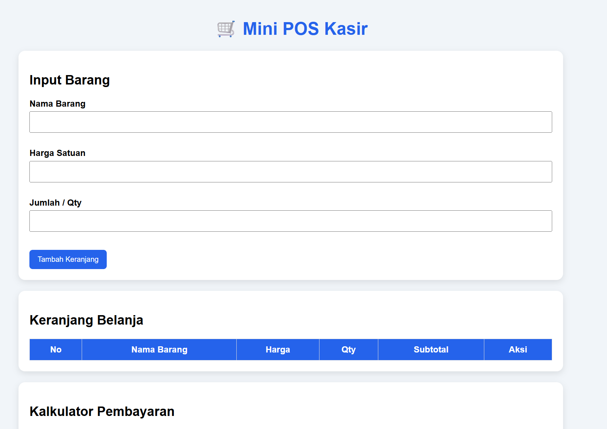
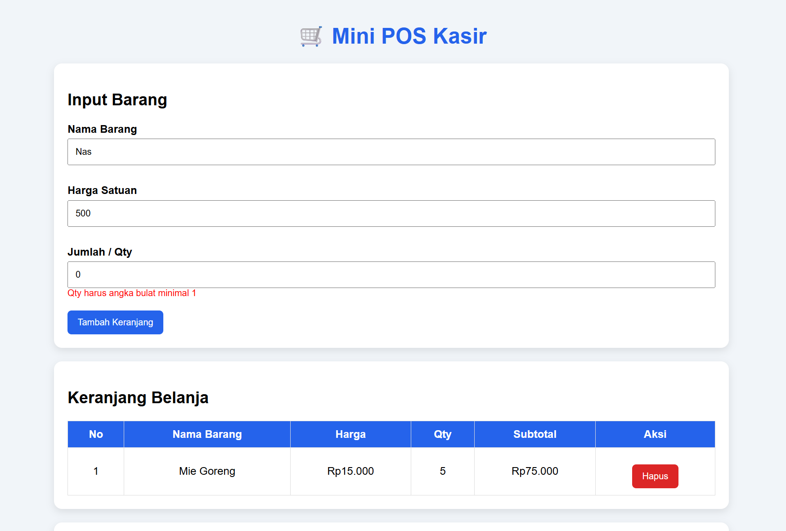
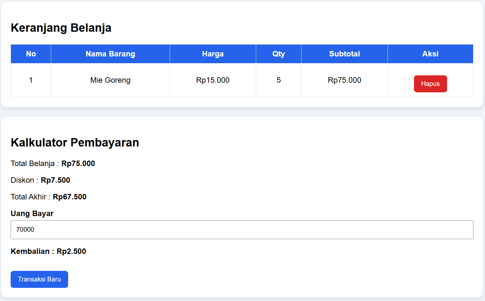

# Mini POS Kasir & Keranjang Belanja

## Identitas

Nama Lengkap : Richard Halim
NIM : 124140084
Kelas Praktikum : RA

## Deskripsi

Aplikasi Mini POS merupakan aplikasi kasir sederhana untuk simulasi toko/kantin kampus.

Aplikasi memiliki fitur input barang, validasi form, perhitungan transaksi otomatis, pengelolaan keranjang, dan penyimpanan data menggunakan LocalStorage.

## Fitur

### Validasi Form

✓ Nama barang wajib diisi  
✓ Minimal 3 karakter  
✓ Harga angka positif minimal Rp500  
✓ Qty angka bulat minimal 1  
✓ Pesan error merah jika input salah  

### Kalkulator

✓ Subtotal = Harga × Qty  
✓ Total belanja otomatis  
✓ Diskon 10% jika total >= Rp50.000  
✓ Menampilkan nominal diskon  
✓ Menampilkan total akhir  
✓ Input uang bayar  
✓ Menghitung kembalian  
✓ Informasi jika uang kurang  

### Manajemen Keranjang

✓ Tambah barang  
✓ Tabel daftar belanja  
✓ Hapus item  
✓ Reset transaksi  
✓ Data tetap tersimpan setelah refresh  

### LocalStorage

Penyimpanan menggunakan:

JSON.stringify()

Pembacaan menggunakan:

JSON.parse()

## Cara Menjalankan

1. Download repository.
2. Buka folder menggunakan VS Code.
3. Jalankan index.html menggunakan Live Server.

## Screenshot

### 1. Tampilan Form Input Barang

### 2. Tampilan Validasi Error

### 3. Tampilan Hasil Perhitungan dan Pembayaran

## Teknologi

HTML5  
CSS3  
JavaScript  
LocalStorage
