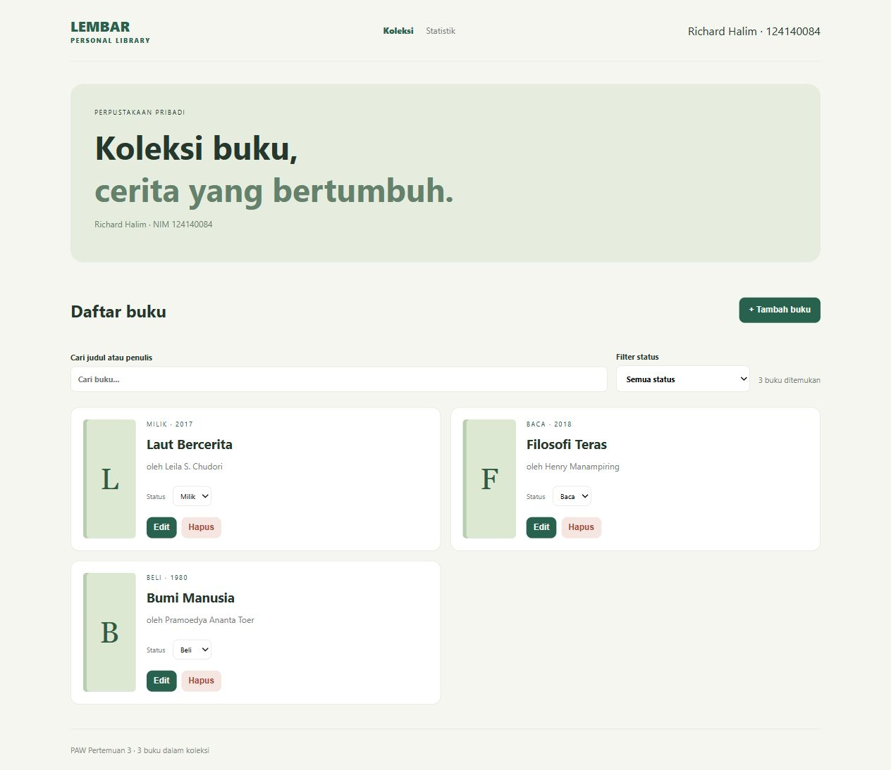
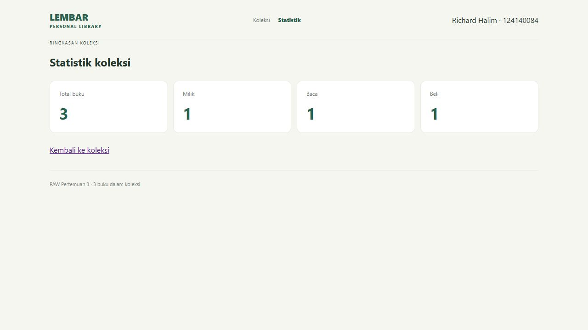
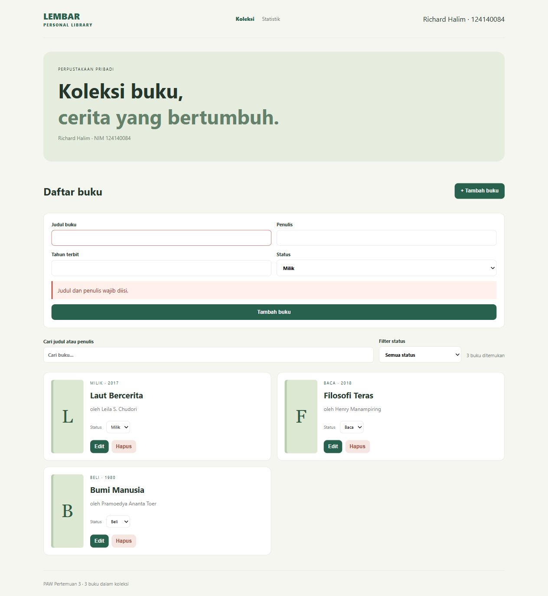
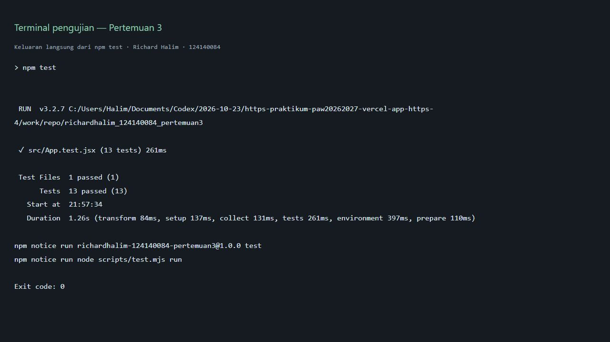

# Manajemen Buku Pribadi

Richard Halim · 124140084 · Kelas RA
Praktikum PAW — Pertemuan 3 (React Basics)

Aplikasi sederhana untuk mencatat koleksi buku. Buku dibagi menjadi tiga status: **milik** (sudah dimiliki), **baca** (sedang dibaca), dan **beli** (ingin dibeli). Status merupakan satu kategori aktif per buku. Data contoh disediakan saat pertama kali aplikasi dibuka.

## Menjalankan di VS Code

Gunakan Node.js 22 atau versi lebih baru.

1. Buka folder `richardhalim_124140084_pertemuan3` melalui **File → Open Folder** di VS Code.
2. Buka terminal melalui **Terminal → New Terminal**.
3. Jalankan:

```bash
npm install
npm run dev
```

Buka alamat yang ditampilkan Vite, biasanya `http://localhost:5173`. Untuk membuat versi produksi, jalankan `npm run build`. Aplikasi React ini perlu dijalankan melalui Vite, bukan dengan membuka `index.html` langsung atau server HTML biasa.

## Fitur

- Menambah buku dengan judul, penulis, status, dan tahun terbit opsional.
- Mengedit informasi, mengganti status, dan menghapus buku dengan konfirmasi.
- Mencari berdasarkan judul atau penulis; dapat digabungkan dengan filter status.
- Melihat jumlah koleksi dan jumlah buku per status pada halaman statistik.
- Menyimpan koleksi di localStorage sehingga tetap ada setelah halaman dimuat ulang.
- Menampilkan pesan untuk input kosong, tahun tidak valid, hasil pencarian kosong, dan kegagalan penyimpanan.

Judul dan penulis yang hanya berisi spasi ditolak. Tahun, jika diisi, harus berupa bilangan bulat dari 0 sampai tahun berjalan. Data berada pada browser yang digunakan, sehingga tidak otomatis tersinkron ke perangkat lain.

## Penerapan React

- **Functional components** dan `useState` mengatur form, pencarian, filter, serta buku yang sedang diedit.
- **useEffect** menyimpan perubahan koleksi ke localStorage.
- **Context API** (`BookContext`) menyediakan koleksi beserta fungsi tambah, ubah, dan hapus untuk halaman lain.
- **React Router** menyediakan halaman koleksi (`/`) dan statistik (`/stats`).
- **Custom hooks:** `useLocalStorage` menangani pembacaan/penyimpanan data dan `useBooks` membaca context serta memeriksa penggunaan di dalam provider.
- **Komponen reusable:** `Form` pada `BookForm.jsx` dipakai untuk tambah/edit, `BookFilter` menerima nilai dan callback filter, serta `StatCard` dipakai berulang pada statistik.
- **PropTypes** memeriksa props komponen. React 18 digunakan agar pemeriksaan PropTypes tetap aktif pada mode pengembangan. Komponen tanpa props memiliki deklarasi kosong.
- Daftar buku memakai ID tetap sebagai `key`. Form edit memakai ID buku sebagai `key` agar isi form berganti saat memilih buku lain.

## Struktur

```text
src/
  components/   # BookForm, BookFilter, StatCard
  context/      # BookContext, Provider, useBooks
  hooks/        # useLocalStorage
  pages/        # Home dan Stats
  App.jsx       # Tata letak dan rute
  App.test.jsx  # Pengujian perilaku aplikasi
  main.jsx      # Entry point
```

## Screenshot

### Koleksi


### Statistik


### Validasi input


## Pengujian

```bash
npm test
npm run build
```

Untuk mode pengujian berulang: `npm run test:watch`.

Terdapat **13 test** dengan Vitest, React Testing Library, dan jsdom: memuat data, menambah dan menyimpan buku, validasi input kosong, validasi tahun, mengedit buku, berpindah form edit, menghapus, membatalkan penghapusan, mencari judul/penulis, memfilter dan menampilkan kondisi kosong, memperbarui statistik melalui navigasi, memulihkan data rusak, serta menangani kegagalan penyimpanan.

Hasil pemeriksaan 23 Oktober 2026: **13/13 test lulus** dan **build berhasil**. Screenshot berikut menampilkan keluaran langsung `npm test` melalui tampilan terminal pengujian lokal. Teks keluaran juga tersedia di [hasil-test.txt](docs/hasil-test.txt).



Runner pengujian menonaktifkan web storage bawaan Node.js pada Node 25+ agar tidak berbenturan dengan localStorage milik jsdom. Penyimpanan aplikasi pada browser tetap berjalan normal.

## Catatan

- File `profil.html` dan dua ilustrasi SVG adalah arsip latihan sebelumnya, bukan aplikasi utama tugas ini.
- Data dari versi lama dimigrasikan saat dibaca: `unread` dan `finished` menjadi `milik`, sedangkan `reading` menjadi `baca`.
- `node_modules`, `dist`, dan `coverage` diabaikan melalui `.gitignore`.
- Acuan: [deskripsi tugas](https://praktikum-paw20262027.vercel.app/pertemuan/3/tugas-praktikum) dan [format pengumpulan](https://praktikum-paw20262027.vercel.app/pertemuan/3/format-pengumpulan).
