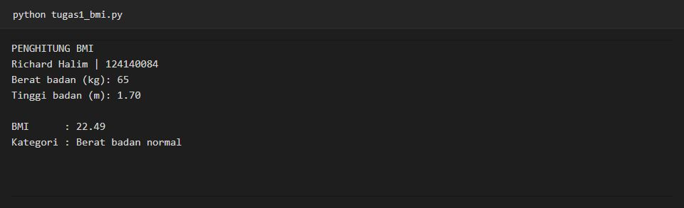
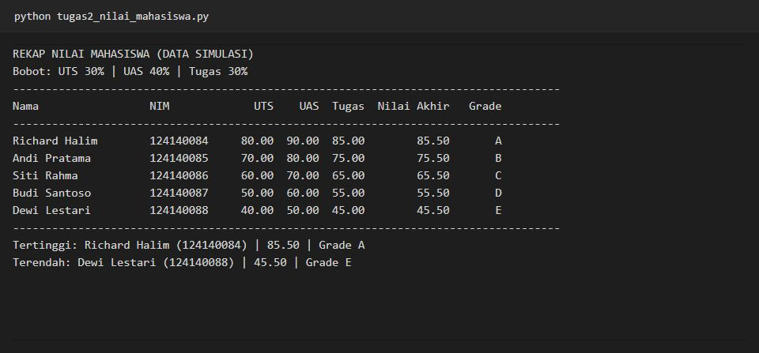
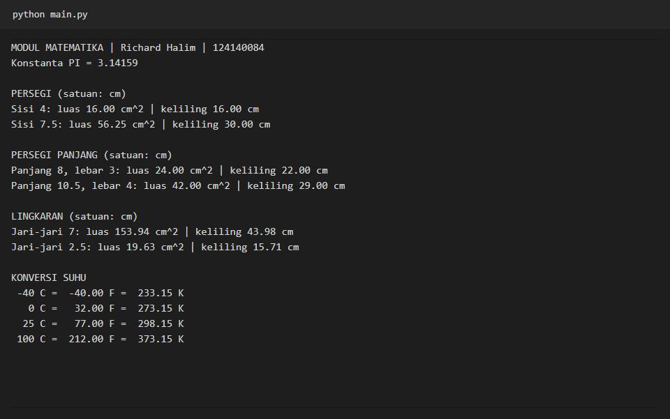

# Pertemuan 4 - Python Dasar

**Richard Halim | NIM 124140084 | Kelas RA**

Folder ini berisi tiga program tugas Python dasar dan beberapa latihan dari materi praktikum. Program menggunakan pustaka bawaan Python, jadi tidak perlu memasang paket tambahan.

## Cara menjalankan

Buka folder `richardhalim_124140084_pertemuan4` di VS Code, lalu buka terminal. Gunakan Python 3.10 atau lebih baru.

```bash
python tugas1_bmi.py
python tugas2_nilai_mahasiswa.py
python main.py
```

Jika terminal masih berada di folder utama repositori, masuk ke folder tugas terlebih dahulu:

```bash
cd richardhalim_124140084_pertemuan4
```

Pada macOS atau Linux, perintah `python` dapat diganti dengan `python3`.

## 1. Penghitung BMI

`tugas1_bmi.py` menerima berat badan dalam kilogram dan tinggi badan dalam meter. BMI dihitung dengan rumus `berat / (tinggi * tinggi)`, lalu hasilnya ditampilkan dengan dua angka desimal.

Fungsi `hitung_bmi()` menghitung hasilnya, sedangkan `kategori_bmi()` menentukan kategori menggunakan `if-elif-else`:

| BMI | Kategori |
|---|---|
| Kurang dari 18.5 | Berat badan kurang |
| 18.5 sampai kurang dari 25 | Berat badan normal |
| 25 sampai kurang dari 30 | Berat badan berlebih |
| 30 atau lebih | Obesitas |

Masukan yang bukan angka, nol, atau negatif akan diminta ulang. Gunakan titik untuk desimal, misalnya tinggi `1.70`. Berat 65 kg dengan tinggi 1.70 m menghasilkan BMI 22.49, yaitu kategori berat badan normal menurut batas pada soal.



## 2. Pengelolaan nilai mahasiswa

`tugas2_nilai_mahasiswa.py` mengolah list berisi lima dictionary. Setiap data memiliki nama, NIM, nilai UTS, nilai UAS, dan nilai tugas. Data mahasiswa dan nilainya digunakan sebagai contoh latihan.

Nilai akhir dihitung oleh `hitung_nilai_akhir()` dengan bobot:

```text
Nilai akhir = 30% UTS + 40% UAS + 30% tugas
```

`tentukan_grade()` membagi hasil menjadi A (>= 80), B (>= 70), C (>= 60), D (>= 50), dan E (< 50). `olah_nilai()` menyusun rekap tanpa mengubah data awal. Hasil ditampilkan sebagai tabel yang memuat nilai komponen, nilai akhir, dan grade.

Fungsi `cari_ekstrem()` mencari mahasiswa dengan nilai tertinggi dan terendah. Jika ada nilai yang sama, semua nama dengan nilai tersebut ditampilkan.



## 3. Modul matematika

`math_operations.py` berisi konstanta `PI = 3.14159` dan fungsi berikut:

- Luas dan keliling persegi.
- Luas dan keliling persegi panjang.
- Luas dan keliling lingkaran.
- Konversi Celsius ke Fahrenheit dan Celsius ke Kelvin.

Setiap fungsi menerima ukuran atau suhu dan mengembalikan hasil perhitungan. `validasi_ukuran()` memeriksa agar ukuran geometri tidak negatif.

`main.py` memanggil semua fungsi dengan beberapa nilai berbeda: dua ukuran untuk setiap bentuk serta suhu -40, 0, 25, dan 100 Celsius. Dua cara impor yang digunakan adalah:

```python
import math_operations
from math_operations import celsius_ke_fahrenheit, celsius_ke_kelvin
```

Jalankan `main.py` untuk melihat hasilnya. `math_operations.py` tidak perlu dijalankan sendiri karena berfungsi sebagai modul.



## Latihan

Folder `latihan/` berisi latihan identitas diri, konversi suhu, tebak angka, validasi password, daftar kontak, dan modul pembuat password acak.

```bash
python latihan/latihan1.py
python latihan/latihan2_suhu.py
python latihan/latihan3_tebak.py
python latihan/latihan4_validasi.py
python latihan/latihan5_kontak.py
python latihan/main.py
```

## Pengujian

Pengujian rumus, batas kategori, validasi masukan, dan jalannya program tersedia di `test_tugas.py`.

```bash
python -m unittest -v
```

Keluaran teks program dan hasil pengujian disimpan di folder `docs/`. Screenshot menggunakan terminal berbasis peramban yang menampilkan keluaran proses Python melalui terminal Windows ConPTY.
