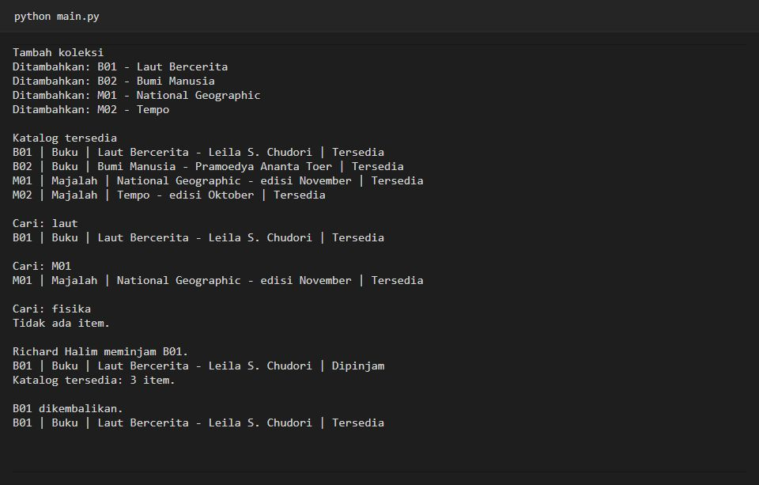

# Pertemuan 5 - Python OOP

**Richard Halim | NIM 124140084 | Kelas RA**

Program ini mengelola koleksi perpustakaan sederhana. Saat dijalankan, program menambahkan buku dan majalah, menampilkan katalog, mencari berdasarkan judul atau ID, lalu mencoba peminjaman dan pengembalian. Koleksi disimpan di memori selama program berjalan.

## Cara menjalankan

Buka folder pertemuan ini di VS Code, lalu jalankan dari terminal:

```bash
cd tugas_perpustakaan
python main.py
```

Gunakan Python 3.10 atau lebih baru. Tidak ada paket tambahan yang perlu dipasang.

## Struktur dan penerapan OOP

| Berkas | Peran |
| --- | --- |
| `tugas_perpustakaan/library_item.py` | Kelas abstrak `LibraryItem` dan turunannya, `Book` dan `Magazine`. |
| `tugas_perpustakaan/library.py` | Kelas `Library` untuk menambah, mencari, dan mengelola ketersediaan item. |
| `tugas_perpustakaan/member.py` | Kelas `Member` untuk menyimpan identitas peminjam. |
| `tugas_perpustakaan/main.py` | Contoh penggunaan seluruh fitur program. |
| `latihan/` | Tujuh contoh dari materi, mulai dari konsep objek hingga kelas abstrak. |

- **Kelas dan abstraksi:** `LibraryItem` menetapkan kontrak `get_detail()` dan menyimpan perilaku umum peminjaman.
- **Pewarisan:** `Book` dan `Magazine` menggunakan kembali identitas dan status dari kelas induk.
- **Enkapsulasi:** koleksi disimpan di `__koleksi`. ID dan peminjam dilindungi sebagai atribut privat, sementara status dibaca lewat properti `is_dipinjam`.
- **Polimorfisme:** katalog memanggil `get_detail()` dengan cara yang sama untuk kedua jenis item. Buku menampilkan penulis, sementara majalah menampilkan edisi.

Pencarian judul mendukung potongan kata dan tidak membedakan huruf besar-kecil. Jika kata kunci cocok dengan ID, program mengembalikan item tersebut. Item yang dipinjam tidak muncul di katalog tersedia, tetapi tetap bisa ditemukan melalui pencarian.

## Contoh keluaran



Acuan latihan dan tugas: [Modul Python OOP](https://praktikum-paw20262027.vercel.app/pertemuan/5).
